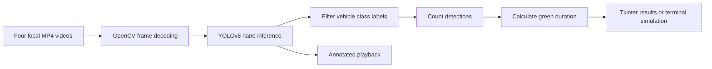

# AI-Powered Smart Traffic Management System

A Python computer-vision prototype that uses YOLOv8 and OpenCV to estimate vehicle counts from four road videos and propose count-dependent green-signal durations. A Tkinter interface presents the results and opens annotated video playback.

Developed by **Stejo Stephen** as an engineering portfolio project. The application demonstrates the perception-to-timing workflow; it does not operate physical traffic lights or establish measured congestion reductions.

## Problem and approach

Fixed-time signals allocate the same green duration regardless of changing demand, potentially leaving busy approaches waiting while quieter approaches retain unused time. This project explores a simple alternative: detect vehicles in road footage, use counts as a traffic-demand proxy, and calculate a suggested duration for each approach.

The four inputs represent North, East, South and West. They are processed sequentially, rather than as synchronized live camera streams.

## Implemented features

- YOLOv8 nano inference on video frames using Ultralytics.
- Counts of cars, trucks, buses and motorcycles.
- Four-direction result cards with vehicle counts and proposed green times.
- Annotated OpenCV video playback from the recommended GUI.
- Alternative GUIs for first-frame results and a terminal simulation.
- Script-relative model and video paths, with missing-resource checks.

## Architecture and workflow



### Detection and density analysis

`finaltest.py` loads `yolov8n.pt`, reads the first frame of each input and filters detection labels to the vehicle classes. Bounding boxes and labels are drawn during playback. Inference uses the installed Ultralytics defaults; there is no project-specific training or accuracy evaluation.

The count is a **snapshot demand proxy**, not vehicles per unit area, queue length, or a count of unique vehicles passing a point. Playback does not refresh the initial result cards. No tracking IDs, region-of-interest calibration or lane segmentation are implemented.

### Adaptive green-time allocation

All GUI variants use:

```text
green_seconds = min(8 + vehicle_count, 30)
```

A baseline of 8 seconds receives one additional second per detected vehicle, capped at 30 seconds. For example, 12 detections produce 20 seconds; 25 produce 30 seconds. These are proposed durations, not a complete intersection scheduler.

`traffic_management.py` instead accumulates detections across all processed frames and uses:

```text
normal:    15 + min(2 * accumulated_detections, 30) seconds
emergency: 15 + 15 seconds
```

The CLI therefore proposes 15–45 seconds normally. Repeated appearances of the same vehicle inflate its count. Its existing emergency branch checks `ambulance` and `firetruck`, but the supplied standard COCO model has neither label: **emergency recognition is not supported by the default model**. A separately validated custom model would be required. The simulation sleeps for one second per direction, not for the proposed green duration.

## Repository structure

```text
.
├── README.md
├── LICENSE
├── requirements.txt
├── .gitignore
├── project_config.py          # Shared portable resource paths and validation
├── finaltest.py               # Recommended GUI and annotated playback
├── traffic_gui.py             # Compact GUI; displays last processed raw frame
├── testfile.py                # GUI with per-direction annotated first frames
├── traffic_management.py      # Sequential terminal/OpenCV simulation
├── Source_vids/
│   └── README.md              # Required input filenames and rights guidance
├── docs/
│   └── project-audit.md       # Source inventory, exclusions and validation
└── tests/
    └── test_project.py        # Resource/path and video failure regression checks
```

## Installation

Use a desktop Python installation with Tkinter and a graphical display. The existing environment was inspected as Python **3.13.5** on Windows. PyTorch is installed transitively by Ultralytics; CPU/GPU compatibility depends on its distribution and your hardware. No CUDA requirement is imposed by this project.

```powershell
git clone https://github.com/xtej0/AI-powered-Traffic-management-system-.git
cd AI-powered-Traffic-management-system-
py -3.13 -m venv .venv
.\.venv\Scripts\python.exe -m pip install --upgrade pip
.\.venv\Scripts\python.exe -m pip install -r requirements.txt
```

On macOS/Linux, use `python3 -m venv .venv` and `.venv/bin/python` in place of the Windows executable. Some Linux distributions require their `python3-tk` system package. A headless OpenCV package is unsuitable for these GUI applications.

### Model and video setup

1. Obtain the official YOLOv8 nano detection weights through [Ultralytics YOLOv8 documentation](https://docs.ultralytics.com/models/yolov8/). Review its licensing before use. To request the official download from the repository root:

   ```powershell
   .\.venv\Scripts\python.exe -c "from ultralytics import YOLO; YOLO('yolov8n.pt')"
   ```

2. Ensure `yolov8n.pt` exists beside `finaltest.py`. The application intentionally checks for a local file before inference.
3. Supply four decodable videos you own or are permitted to use:

   ```text
   Source_vids/north.mp4
   Source_vids/east.mp4
   Source_vids/south.mp4
   Source_vids/west.mp4
   ```

Weights and videos are excluded from Git. The original local footage has no supplied license or source attribution, so it is not redistributed. There is no bundled sample dataset. No API keys or environment variables are required.

### Run

```powershell
.\.venv\Scripts\python.exe finaltest.py
```

The initial inference finishes before the Tkinter results appear. Click a video button for annotated playback; press **q** in the OpenCV window to stop that playback and return to the results. Playback runs inside the Tk callback, so the result window can be unresponsive until playback ends.

Alternative entry points:

```powershell
.\.venv\Scripts\python.exe testfile.py
.\.venv\Scripts\python.exe traffic_gui.py
.\.venv\Scripts\python.exe traffic_management.py
```

In the CLI, **q** ends the current direction and processing continues with the next direction. The compact `traffic_gui.py` displays the raw frame from the last processed direction; it is not an annotated multi-camera dashboard.

### Checks

```powershell
.\.venv\Scripts\python.exe -m unittest discover -s tests -v
.\.venv\Scripts\python.exe -m compileall -q finaltest.py testfile.py traffic_gui.py traffic_management.py project_config.py
.\.venv\Scripts\python.exe -c "import cv2, numpy, tkinter; from ultralytics import YOLO; from PIL import Image; print('Imports OK')"
```

Missing files produce an explicit setup error. A decode/inference error in the GUIs is surfaced rather than silently reported as an empty road. Scripts are executable entry points and create windows when imported; import `project_config` for resource helpers instead.

## Demonstration assets

No screenshots are published in this repository. Local detection screenshots include third-party footage with unverified redistribution rights, and the supplied polished dashboard is a concept rather than the implemented Tkinter interface. Neither is presented as evidence of additional implemented features.

## Technical challenges and limitations

- First-frame sampling can be unrepresentative; lighting, occlusion, camera angle and model errors affect counts.
- The CLI accumulates repeated detections without tracking; counts vary with video length.
- Timings use a hand-written heuristic, without measured throughput or delay optimization.
- No synchronized signal phases, amber/all-red intervals, pedestrian handling or hardware integration exist.
- Emergency priority requires an appropriate custom model and validation.
- Inference and playback block the GUI thread. Videos are processed sequentially and playback is not paced to source FPS.
- No detection accuracy, FPS benchmark or real-world congestion reduction has been measured.
- The existing environment was used for verification; a clean installation is a separate reproducibility check.

## Future improvements

Track unique vehicles across a calibrated counting line; sample frames continuously; separate inference from the GUI thread; evaluate detection and timing against labeled traffic data; implement and test safe signal-phase scheduling; and train a licensed, validated emergency-vehicle model if that feature is required.

## License

Project source is covered by the existing [MIT License](LICENSE), copyright 2026 Stejo Stephen. This does not relicense third-party dependencies, model weights, footage or imagery. Ultralytics publishes [separate licensing terms](https://www.ultralytics.com/license), including AGPL-3.0 and enterprise options; review the terms applicable to your intended distribution and use.
